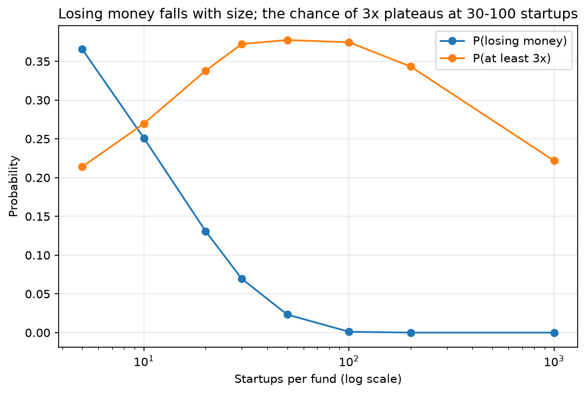
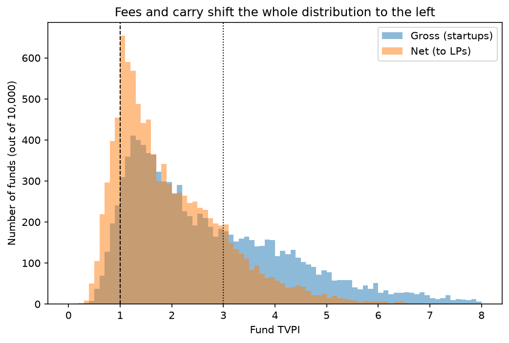
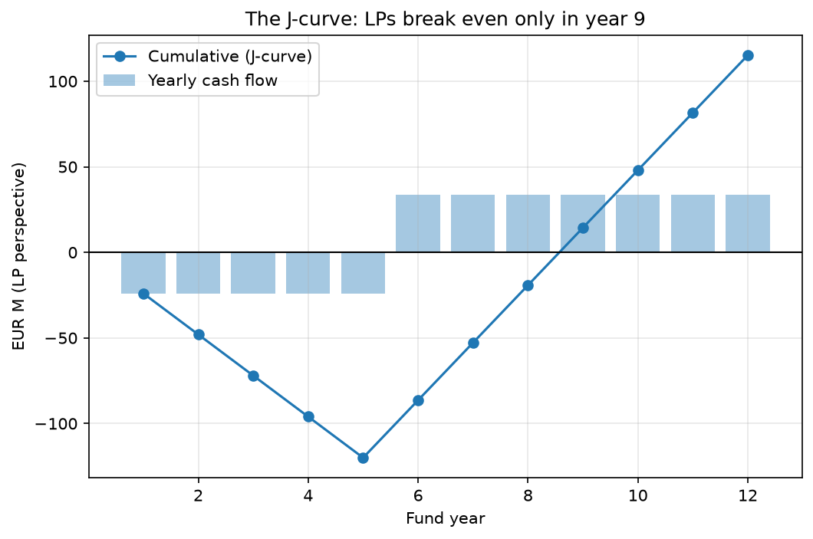

# Power Law Lab: how many bets does a VC fund need?

A Monte Carlo model that plays the same venture capital fund 10,000 times to answer one question:
**how should a €120M fund build its portfolio to maximise the chance of returning 3x to its investors, net of costs?**

> Work in progress: I'm building it one phase at a time, and each phase lands as its own commit.

## Roadmap

- [x] Phase 1: outcome of a single startup (power-law distribution from Correlation Ventures data)
- [x] Phase 2: portfolio size vs risk and return
- [x] Phase 3: fund economics (management fees, follow-on reserves, dilution, carry) to go from gross to net
- [x] Phase 4: timing (J-curve, IRR, DPI)
- [x] Phase 5: strategy comparison and a 2-page memo
- [ ] Phase 6: interactive Streamlit app

## Data and assumptions

Every input of the model is in [`data/outcome_buckets.csv`](data/outcome_buckets.csv), with its source. The model runs under two scenarios.

### Base scenario: Correlation Ventures

Correlation Ventures analysed more than 21,000 venture financings between 2004 and 2013 ([Seth Levine, 2014](https://sethlevine.com/archives/2014/08/venture-outcomes-are-even-more-skewed-than-you-think.html)). It is the most widely cited dataset on venture outcomes, and an update published in 2019 shows almost the same picture: nearly two thirds of financings still lose money and fewer than 4% return more than 10x ([Seth Levine, 2019](https://sethlevine.com/archives/2019/09/the-markets-are-great-but-venture-outcomes-havent-changed-much.html)).

| Outcome | Probability | How it is obtained |
|---|---|---|
| Below 1x | 65% | Stated in the source |
| 1x–5x | 25% | Derived: 35% at or above 1x, minus 10% at 5x or more |
| 5x–10x | 6% | Derived: 10% at 5x or more, minus 4% above 10x |
| Above 10x | 4% | Stated in the source |

### Optimistic scenario: European survey

A 2023 survey of 885 European venture capitalists by Vlerick Business School and seven other business schools found that 9% of investments return more than 10x ([Vlerick, 2023](https://www.vlerick.com/en/insights/45-per-cent-of-european-venture-capital-investments-fail-or-do-not-secure-high-returns/)). The survey does not report the other buckets, so I keep the base scenario and change two numbers:

- **Above 10x:** 9% instead of 4%, from the survey.
- **Below 1x:** 60% instead of 65%. This is my assumption, so that probabilities still add up to 100%.

### Limits

- **Old data.** The base dataset ends in 2013; the 2019 update suggests the shape of the distribution has not changed much.
- **Financings, not companies.** Correlation counts each round separately, so one company can appear more than once.
- **Mostly US data.** It may not describe European funds today.
- **The survey is self-reported.** Investors answering a questionnaire tend to be optimistic, which is why it is the optimistic scenario and not the base case.
- **Ranges inside each bucket are my choice.** In particular, the 100x cap on the top bucket is a placeholder that I revisit in the next step.

## Phase 1 results: a single startup

Simulating 10,000 single investments (base scenario):

| Statistic | Value |
|---|---|
| Mean multiple | 2.75x |
| Median multiple | 0.52x |
| Deals written off to zero | 32% |
| Value produced by the best 5% | ~60% |

The typical startup loses half of the money, but a few outliers lift the average to 2.75x. Returns depend on catching those outliers, which is why portfolio size matters (phase 2).

## Phase 2 results: how many startups does a fund need?

We simulate 10,000 funds for each portfolio size, with equal tickets in every startup.

- Diversification does not change the expected return (about 2.75x), only the risk.
- Below about 10 startups, a fund is more likely to lose money than to return 3x.
- The probability of losing money falls to about 7% with 30 startups and is close to zero above 100.
- The chance of 3x plateaus at about 37% between 30 and 100 startups, then declines as the fund converges to the average.
- This supports the typical seed portfolio of 30-50 companies, assuming no selection skill.

Notebook: `notebooks/02_portfolio.ipynb`

### Sensitivity test: the 100x cap on home runs

The data only say that 4% of startups return more than 10x, so the 100x upper limit is our assumption. Changing only the cap:

| Home-run cap | Mean multiple per startup |
|---|---|
| 100x | 2.73x |
| 1000x | 9.67x |

A 1000x cap would imply that a diversified fund returns about 10x, far above the roughly 3x of top-quartile VC funds. We keep 100x as the base case because it is consistent with observed fund returns. A power-law (Pareto) tail would be a more realistic extension.

Details: `notebooks/02_portfolio.ipynb`

## Phase 3 results: what LPs actually receive

We apply a 2% annual management fee for 10 years and 20% carried interest to 10,000 simulated funds of 30 startups each (EUR 120M fund).

| Fund of 30 startups | Gross | Net to LPs |
|---|---|---|
| Mean TVPI | 2.76x | 1.96x |
| P(TVPI < 1x) | 6.8% | 15.4% |
| P(TVPI ≥ 3x) | 36.4% | 16.1% |

- Fees and carry take about 0.8x of the average multiple.
- After fees, the chance of losing money more than doubles and the chance of 3x is more than halved.
- Only EUR 96M of the EUR 120M is invested, so startups must return 1.25x just for LPs to break even, and about 4.4x for LPs to get 3x.
- After fees, the average fund barely beats public markets. LPs pay for manager selection, not for access to the asset class.

Notebook: `notebooks/03_fund_economics.ipynb`

## Phase 4 results: timing, IRR and the J-curve

TVPI says how much LPs get back, not when. We model the average fund (1.96x net) with simple timing assumptions: LPs pay in EUR 24M a year in years 1-5, and exits return EUR 235.2M in equal parts in years 6-12.

- The LP balance bottoms out at -EUR 120M in year 5 and turns positive only in year 9.
- IRR from cash flows is 12.1%, versus 5.8% if all capital were locked up for 12 years, because each euro is invested for about 6 years on average.
- Same TVPI, very different IRR: LPs look at TVPI, IRR and DPI (cash actually returned) together.
- The IRR depends heavily on the timing assumptions; later exits would lower it while leaving TVPI unchanged.

Notebook: `notebooks/04_timing.ipynb`

Phase 5: concentrate vs diversify strategy comparison

- Add SCENARIOS (base, skilled) and pass scenario through pick_bucket, draw_outcome, simulate_fund
- Compare average vs skilled manager across 5-200 startups, net of fees
- Average manager: P(3x) peaks at ~15 startups; skilled: keeps rising with size
- Add strategy chart and README section

Notebook: `notebooks/05_strategy.ipynb`

## Author

Francesco Moscogiuri, Finance MSc at Nova SBE. [LinkedIn](linkedin.com/in/francesco-moscogiuri) · [Southern Signals](https://francescomoscogiuri.substack.com/?utm_campaign=profile_chips)
